  

### approach

I build minimalist utilities with sharp design for Windows, Android and Telegram. Every tool does one job well: local-first, fast, zero-telemetry and no clutter. Beyond code I do web design, 3D modeling, cover art and photo editing.

### selected projects

- [Exolute](https://play.google.com/store/apps/details?id=com.saieesoft.exolute) — Android currency converter with offline mode and rate history
- [@AskAnonApp](https://t.me/AskAnonymousBot) — anonymous questions and replies inside Telegram, no message storage
- [@VaultysApp](https://t.me/VaultysBot) — alerts on edited and deleted messages, saves view-once media
- [SwiftService](https://saiees.github.io/#projects) — Windows cleanup, registry repair and network tuning, 100% local

— for project enquiries: [saiees@duck.com](mailto:saiees@duck.com) · [Telegram](https://t.me/nullwr) · [web-site](https://saiees.github.io)
